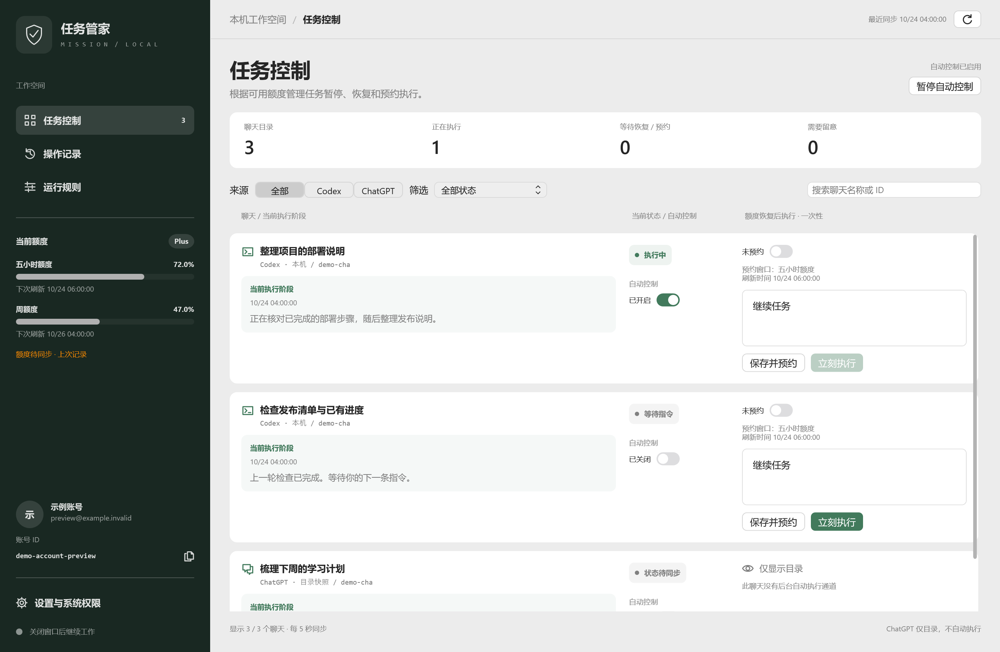
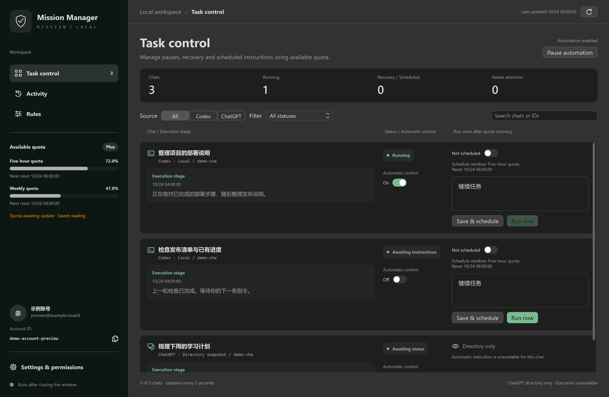
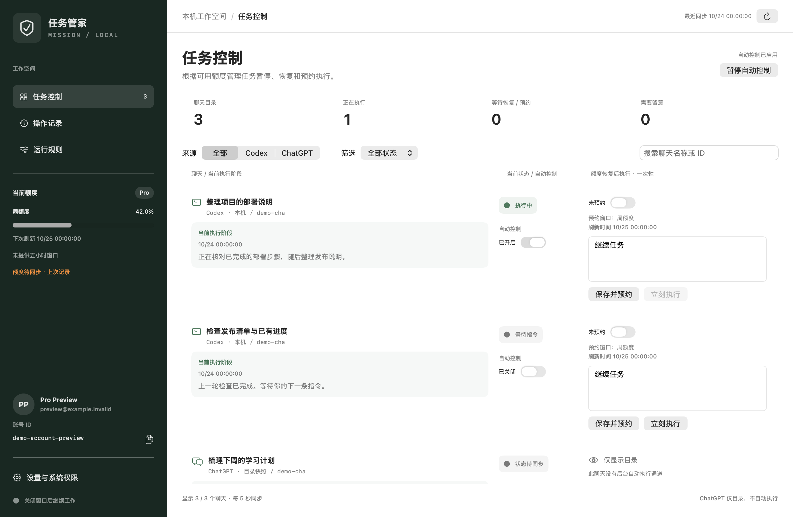
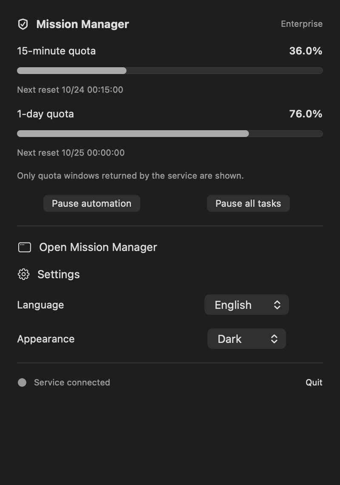
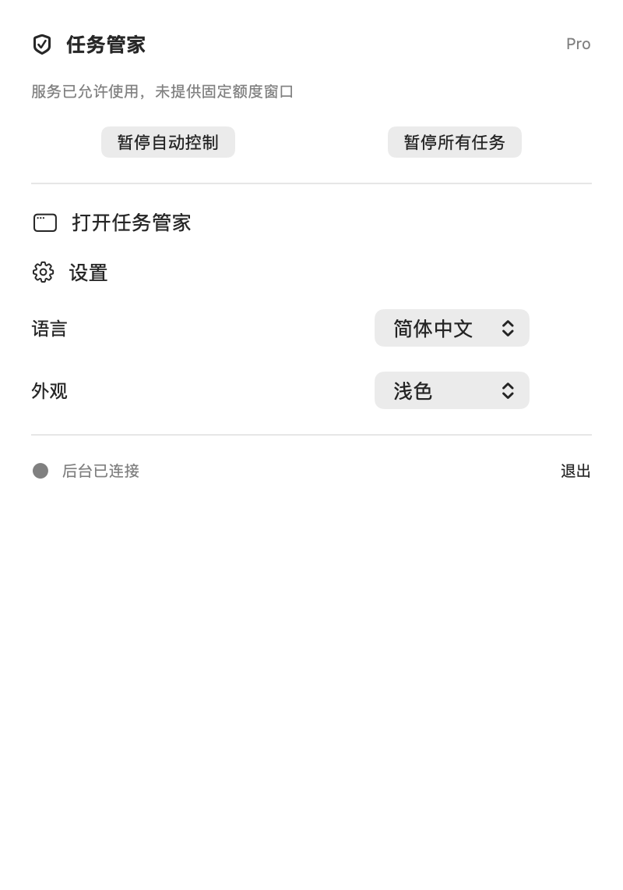
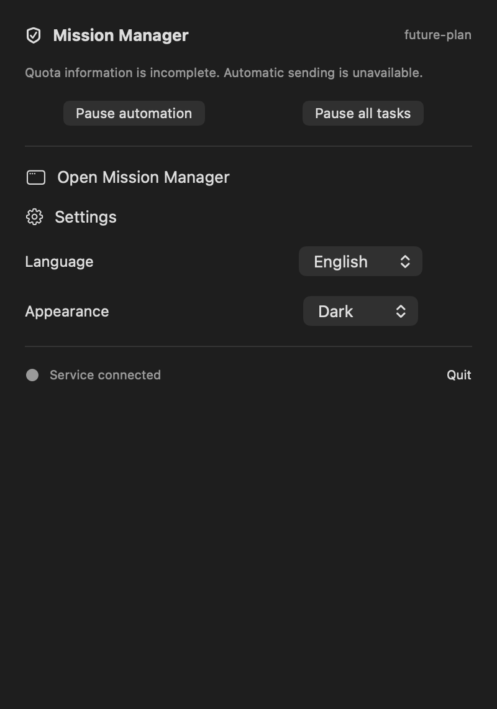
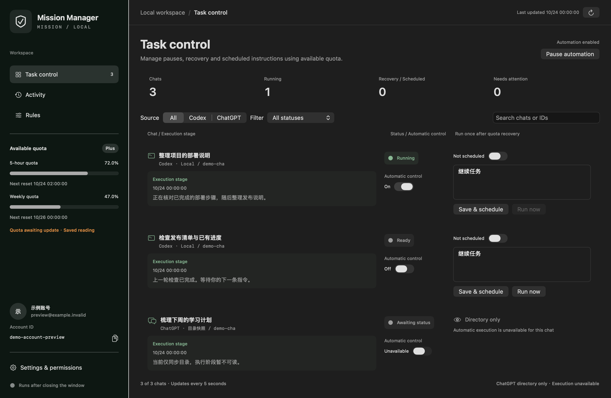
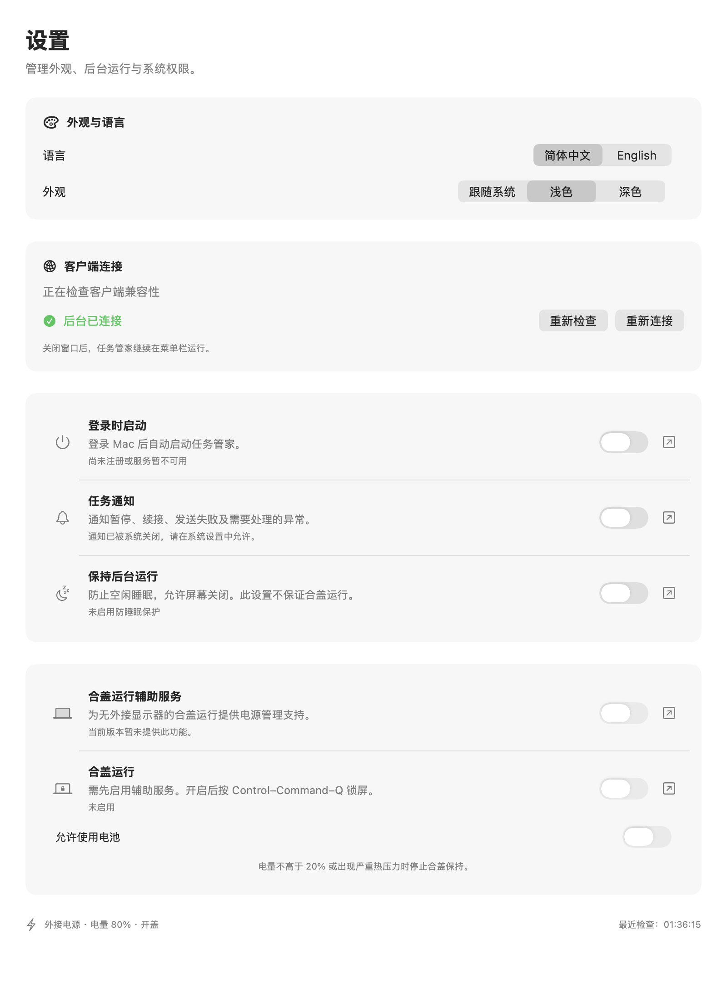
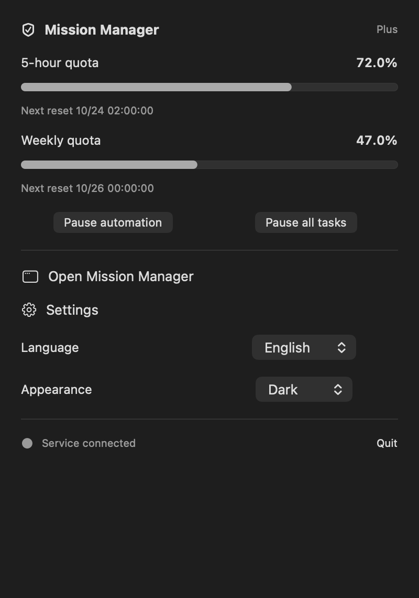

# Codex Mission Manager · 任务管家

macOS 与 Windows 原生聊天任务管理应用。根据可用额度暂停和续接已授权的 Codex 任务，安排额度恢复后的一次性指令，并查看执行阶段与发送记录。

A native macOS and Windows companion for quota-aware Codex task control, one-time scheduled instructions, and confirmed delivery records.

[下载 macOS DMG](https://github.com/Dddysun/Codex-Mission-Manager/releases/tag/v0.2.1-preview.6) · [Windows 预览安装包](https://github.com/Dddysun/Codex-Mission-Manager/releases) · [产品总蓝图](docs/PRODUCT_BLUEPRINT_V0.1.md) · [发行状态](docs/RELEASE_STATUS.md)

**V0.2.1 公开预览版。** 按实际订阅响应识别五小时、周与其他额度窗口，支持无固定窗口的明确服务许可；保留中英文、系统深色模式和原生菜单栏。安装前请阅读发行限制。

## Windows 原生预览

Windows 版本使用 WPF 原生窗口和携带 Python 的每用户 EXE 安装器。本轮按当前 Mac 原生设计重做主窗口、设置、托盘、中英文和浅深色主题，见 [界面还原说明](docs/WINDOWS_UI_PARITY.md)。官方客户端 `26.1021.3705.0` 已完成真实账号额度、两个已有聊天快照及执行阶段的只读核验，源码仅为该 exact 版本提供适配；真实暂停、续接及发送动作仍须单独验收。功能与剩余缺口见 [Windows 移植清单](docs/WINDOWS_PORT.md)，安装方法见 [Windows 安装与卸载](windows/INSTALL_README.md)。

[Windows 发行文件（含 EXE、便携 ZIP 与校验摘要）](https://github.com/Dddysun/Codex-Mission-Manager/releases)。最终 Windows 10 x64 回归共 219 项，其中 215 项通过、4 项 Mac 专属测试跳过；6 项宿主测试及 10 组原生渲染通过。检查未向真实聊天发送消息，详见 [本轮验收记录](docs/windows-parity-validation.json)。

以下为 Windows 原生 WPF 窗口的示例数据渲染，不展示真实账号或聊天。





## 界面预览

以下界面使用示例数据。 V0.2.1 的订阅状态示例如下。









以下为原生设置与基础窗口示例。







## V0.2.1 订阅适配

按服务返回的窗口时长和使用许可控制任务，不根据 Free、Plus、Pro 等名称猜测额度。没有五小时窗口时仍可识别实际周窗口或其他窗口；没有固定窗口时明确显示服务许可，未知数据禁止发送。一次性预约显示实际目标及刷新时间；同一账号更换订阅不再被误判为换账号。详见 [订阅适配规则](docs/SUBSCRIPTION_ADAPTATION.md)。

## 功能

- 原生聊天列表，展示来源、当前状态、公开执行阶段和自动控制许可。
- 在额度不足时暂停符合条件的受管任务；额度可靠恢复后核对原会话并续做。
- 为下一额度窗口安排一次性自定义指令，或手动点击“立刻执行”并查看回执。
- 查看账号实际返回的五小时、周及其他额度窗口与刷新时间，以及订阅类型和账号信息。
- 原生操作记录，保留暂停、续接、预约和发送结果。

V0.2 增加系统、浅色和深色外观，以及即时切换的简体中文和 English 界面。菜单栏保留固定图标，左键或右键均可打开额度与控制面板。

## V0.2 更新范围

### 状态与兼容性

全局自动控制暂停时，单聊接管请求显示“等待全局启用”，可直接取消；连接失败显示原因并提供重试入口。待处理请求不再统一显示为“连接中”。

客户端兼容状态由前后端共享的配置提供。控制前重新检查当前客户端版本，避免客户端升级后设置页提示与后台状态不一致。

兼容配置覆盖 build 20770 和 21828。21828 已完成本机只读握手与会话快照检查；真实暂停、续接和即时发送的验收状态见发行说明，不能由连接成功推断控制成功。未知版本停止控制并提示更新。

### 权限设置

设置页采用统一的用途说明、真实状态、滑块和系统设置入口。新安装默认关闭可选开关，升级保留已有偏好。

- **登录时启动：**登记或移除系统登录服务，按真实注册状态显示。
- **任务通知：**应用通知偏好与 macOS 授权共同决定是否发送通知。关闭滑块停止应用通知，不代表撤销系统授权；系统权限需在系统设置中管理。
- **保持后台运行：**防止空闲睡眠并允许显示器关闭，不等同于合盖运行权限。
- **合盖运行：**当前公开试用版本暂不可用，设置中保留功能说明和系统设置入口。

### 菜单栏

面板根据当前账号的实际数据展示订阅类型、五小时额度、周额度和刷新时间；缺失或过期数据明确标记，不将未提供额度视为无限。

额度下方并列提供全局自动控制和“暂停所有任务”。后者只处理已授权接管、正在执行且未等待人工审批或输入的受管聊天；逐项确认结果。手动暂停后任务保持手动状态，恢复全局自动控制不会隐式恢复这些任务。

面板还提供打开主窗口、设置、语言、外观和退出入口。语言与外观偏好保存后即时生效。

## 安装条件与运行行为

- Apple Silicon Mac，macOS 14 或更新版本。
- 已安装并登录兼容的 ChatGPT/Codex 桌面客户端；安装包不分发原客户端。
- 应用包含前端、后端和精简 CPython，日常使用无需安装 Python、Node、Homebrew 或开发工具。
- 普通 ChatGPT 聊天仅显示可用目录，不自动执行。本应用不附带个人云端聊天快照，也不提供完整云端目录同步。

关闭主窗口后继续在菜单栏运行。退出应用停止其后台与电源保持，不主动中断原客户端正在执行的聊天。新安装默认暂停全局自动控制，核对账号和聊天后再启用。

界面每 5 秒读取后台缓存。V0.2.1 build 5 起，正常采集完成后等待 30 秒；临近额度阈值、额度不足或存在待执行预约时等待 10 秒。实际两轮开始时间还需加上采集与控制处理耗时；异常连接重试仍使用独立退避。

客户端已有配置或项目路径引用受保护的“文稿”文件夹时，首次启动可能触发 macOS 文件夹访问提示。请在解锁后处理该提示；等待选择期间，客户端初始化可能超时，自动发送保持停用。应用不会替用户授予系统权限。

检测到旧版后台时，应用优先连接现有服务，避免启动重复执行器。迁移旧账本需先停止旧服务，再显式运行 `backend/app_host.py --migrate`；目标已有账本时拒绝覆盖。

## 当前发行限制

当前预览发行没有 Developer ID 签名与 Apple 公证，其他电脑可能被 macOS 阻止打开。合盖辅助服务未开放；锁屏、熄屏和无外屏合盖下的完整发送流程仍需单独实机验收。Intel Mac、多账号同时登录和自动升级尚未提供。Windows x64 为独立原生预览，具体限制见 Windows 移植清单。

客户端控制依赖版本敏感的本机通信通道。支持范围和已完成的验收以 [发行状态](docs/RELEASE_STATUS.md) 为准。

## 架构与构建

SwiftUI / AppKit 原生界面通过本机 JSON 接口连接 Python 标准库后端，SQLite 保存本机状态。主窗口不使用 WebView。界面同步不会覆盖正在编辑的指令草稿。

构建需要 Apple Silicon Mac、macOS 14+、Apple Command Line Tools 和可重定位 CPython 3.12 目录。应用使用者不需要这些工具。

```sh
python3 scripts/fetch_runtime.py --destination /tmp/mission-python-v021
python3 scripts/build.py --python-runtime /tmp/mission-python-v021/python --output /tmp/mission-build-v021
python3 scripts/make_dmg.py --build /tmp/mission-build-v021
```

正式签名构建需同时提供 `MISSION_TEAM_ID` 与 `MISSION_SIGN_IDENTITY`，证书和密码不进入仓库。公证使用本机 Keychain 中配置的 notarytool profile。没有发行签名时，不开放管理员辅助服务。

## 数据与来源

账号、聊天、令牌、配置和任务账本保存在本机，不包含在仓库或安装包中。运行数据位于用户 Application Support；连接旧版服务时沿用其本机数据目录。

调度规则部分改编自 MIT [cat2mao/codex-quota-monitor](https://github.com/cat2mao/codex-quota-monitor)，许可证见 `third-party`。电源架构参考 [Amped](https://github.com/gustaferiksson/amped) 和 [Sleepless](https://github.com/Aboudjem/Sleepless)，电源代码独立实现。CPython 运行环境保留 PSF 及内置第三方许可证。

## 检查

```sh
python3 -m unittest discover -s backend/tests -v
PYTHONPATH=backend python3 -m unittest discover -s tests -v
node backend/tests/test_sidebar.cjs
```

V0.2.1 已通过190项后端测试（其中39项订阅专项）、4项打包宿主测试、原生控制契约和 JavaScript 检查；8个原生订阅视图渲染与 DMG 检查通过。GitHub 独立构建及公开发行成功。测试与发行验证的范围、真实聊天是否参与以及剩余限制，统一记录在 [发行状态](docs/RELEASE_STATUS.md) 和 `docs/validation.json`。
