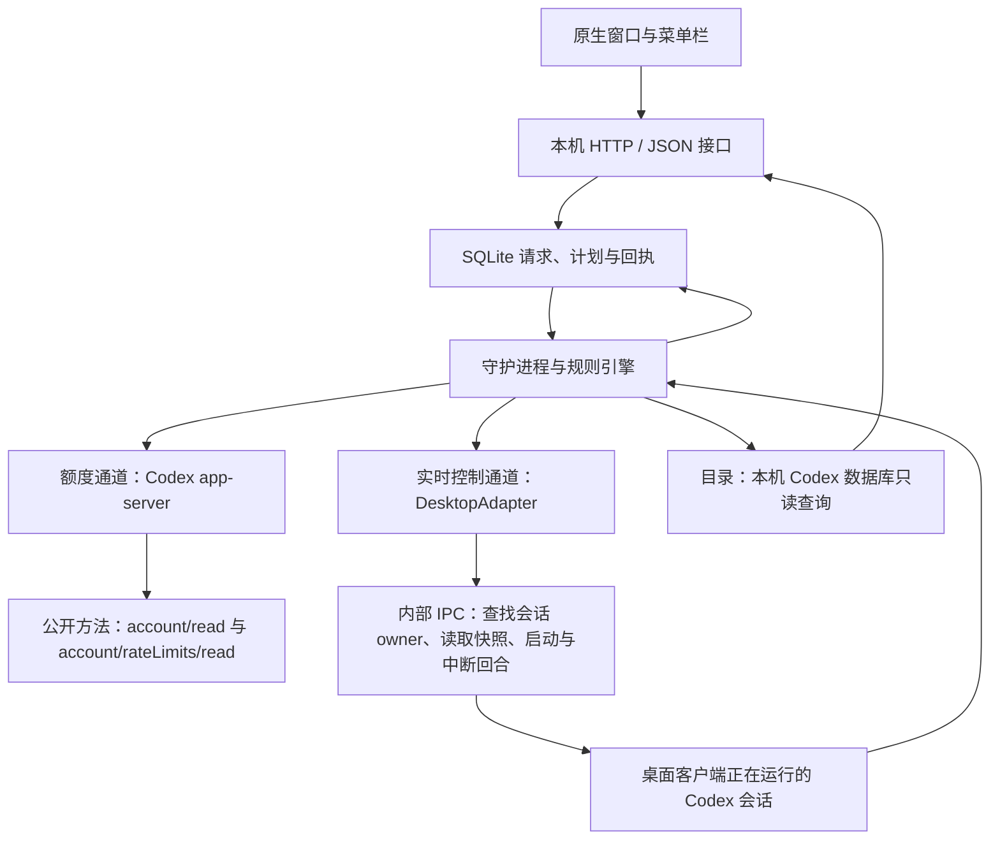
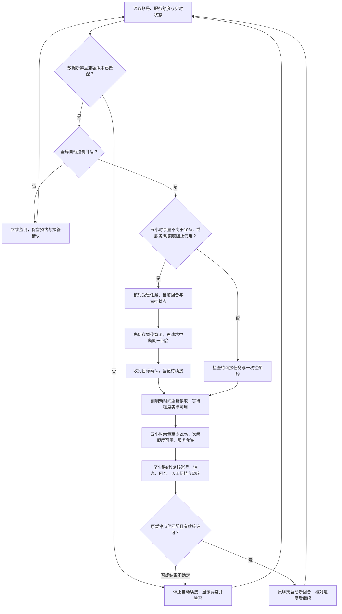

# V0.2 控制流程与接口边界核对

核对日期：2026-10-25。代码基线：`ba2d6a96e4aa19ca9ae0b7826dd02b8de2fff437`，发行版 `v0.2.0-preview.4`。本文描述当前实现、证据与缺口，不代表已经修改运行策略或完成真实聊天控制验收。

## 结论

- 无外屏合盖功能尚未交付。直接门槛是预览构建主动禁用管理员辅助服务；发行身份、异常恢复与实机闭环仍有缺口。Developer ID 不是物理上实现防合盖睡眠的唯一可能，配置证书也不能代替验收。
- OpenAI 已公开 Codex app-server 的额度、会话、启动和中断方法。当前额度读取使用该协议；接管桌面里已在执行的会话仍使用版本敏感的内部 IPC。
- 当前自动执行目标是本机 Codex 会话。ChatGPT 目录来自本地 seed 快照，不能描述为完整、持续同步并可控制所有 ChatGPT / Work 会话的接口。

## 当前组件与通道

额度通道以 stdio JSON-RPC 调用已安装的 Codex CLI，并使用本机已有登录。额度 probe 使用隔离的 SQLite / 日志目录，避免误把独立 app-server 的会话状态当作桌面实时状态。Goal 状态修改另走 app-server；实时回合中断与启动仍由桌面 IPC 路由。

内部 IPC 的连接、消息封装、owner/follower 路由和协议版本均需适配。`turn/start`、`turn/interrupt` 是守护进程抽象方法名，不能据此认定每次桌面控制都直接调用公开 app-server。

代码依据：[desktop.py](../backend/desktop.py)、[guardian.py](../backend/guardian.py)、[catalog.py](../backend/catalog.py)。

## 自动暂停与续接

这是“中断当前回合，再开启续做回合”，不是冻结和恢复整个进程。已写入的文件、已提交的外部操作和独立后台命令不因中断自动回滚。

正常采样间隔默认60秒，临近阈值或有预约时15秒；服务返回的 `resetsAt` 用于安排重查，不能只凭本机时钟认定额度已恢复。审批/输入等待不主动中断；身份变化、消息更新和无法确认的发送转入等待或人工核对。

规则依据：[control_policy.py](../backend/control_policy.py)、[guardian.py](../backend/guardian.py)。

## 控制入口的区别

- **关闭全局自动控制：**停止自动动作，现有聊天回合继续执行；一次性额度预约也受全局开关约束。
- **单聊自动控制：**保留接管意图；全局关闭时等待，开启后再接管。当前实现同时启用自动发现：全局开启后，新发现且没有明确关闭偏好的可用聊天可能自动纳入，不是严格逐聊 opt-in。
- **暂停所有任务：**处理提交时冻结的受管、允许控制的任务集合；跳过审批/输入等待和空闲聊天。人工保持在中断前保存，恢复全局控制不自动解除它。受管集合可能包含全局授权后自动发现的聊天。
- **下一窗口执行：**独立于单聊自动续接许可的一次性计划，但仍要求全局开启；必须观察到比预约时更新的主窗口 reset，且额度实际可用。同聊自定计划优先于默认续接。预约后出现新回合，需要重新确认。
- **立刻执行：**可在全局自动控制暂停时显式提交；仍须额度、账号、聊天空闲、无审批/Goal及历史一致。请求90秒过期，不偷偷延后到未来发送。
- **发送结果不确定：**持久保存唯一标识，核对结果或要求人工处理，不盲目重复发送；不宣称跨系统严格 exactly-once。

## 无外屏合盖运行的实际卡点

普通后台开关使用 `PreventUserIdleSystemSleep`。Apple 说明它防止空闲睡眠，但机盖关闭等原因仍可让系统睡眠。[Apple 电源断言说明](https://developer.apple.com/documentation/iokit/kiopmassertiontypepreventuseridlesystemsleep)

现有增强模式设计为：用户开启并锁屏后，由管理员辅助服务设置全局睡眠覆盖。代码固定调用 `pmset -a disablesleep 1`，不是取得一个名为“合盖权限”的普通系统隐私开关。需要管理员服务授权、可信身份校验以及可靠还原；仅看到 `SleepDisabled=true` 不证明无外屏时网络、桌面客户端和发送通道持续可用。本文未执行该命令。

预览构建没有配置发行团队身份，`releaseSigned` 为 false；主程序、设置控件和 helper 均主动拒绝启用。Apple 的 Developer ID 用于外部分发身份和 Gatekeeper 验证，不能当作合盖功能已经实现的证明。[Developer ID](https://developer.apple.com/developer-id/)、[SMAppService](https://developer.apple.com/documentation/servicemanagement/smappservice)

当前代码已设计失联45秒、断电、低电量和热压力撤销保护，但审查发现尚未修复的恢复缺口：

1. helper 重启恢复时，未确认恢复命令成功就删除恢复日志。
2. 睡眠覆盖状态读取为未知时，部分路径可能清除 active 与恢复依据。
3. 锁屏确认由前台应用监听事件，helper 本身未独立核验锁定状态；未验证无外屏硬件闭环。

代码依据：[PowerHelper.swift](../native/PowerHelper.swift)第14–23、38–60、70–100行，[Shared.swift](../native/Shared.swift)第14、34–35行，[App.swift](../native/App.swift)锁屏与 helper 路径。

因此，发行签名、恢复可靠性和以下实机验收均完成之前，增强模式仍属于未交付能力：无外屏且接电合盖、锁屏、熄屏、真实额度读取与指令回执、退出/崩溃/重启后的还原，以及断电/低电量/热压力时的退出。

## OpenAI 的公开能力与当前覆盖

官方 [Codex app-server 文档](https://learn.chatgpt.com/docs/app-server)公开了 `account/rateLimits/read`、`thread/list`、`thread/read`、`thread/resume`、`turn/start`、`turn/interrupt` 等能力。`thread/resume` 是重新加载会话，不是恢复一个被冻结的运算进程。

公开方法的存在不等于已经验证第三方可以无缝接管任意桌面进程中正在运行的回合。官方 [CLI 参考](https://learn.chatgpt.com/docs/cli/reference)同时说明 app-server 主要用于开发调试，可能变化。公开文档还包含共享服务和 Unix socket 路线；应优先验证这些路线是否对应当前桌面会话的同一活动回合，再考虑替换现有内部 IPC，不能仅因接口名称相同就直接切换。

独立 [Agents API](https://developers.openai.com/api/docs/guides/agents-api/overview)能够运行和续做自建云端 agent，按 API 计费；它不能直接证明可以管理既有 ChatGPT 客户端会话或读取其订阅余量。本次检索没有找到覆盖所有普通 ChatGPT / 云端 Work 聊天的统一第三方控制接口说明；当前应用也未接通这些会话的自动执行。

当前订阅适配仍有两项缺口：主额度解析强制300分钟；次级窗口按周额度处理但尚未验证窗口长度。因此 UI 显示 Free / Plus / Pro 计划名称，不代表已经适配所有计划的额度结构。服务返回的 `codex` 桶也不能等同所有 ChatGPT 模型额度。

## 建议的验收顺序

1. 明确自动发现与逐聊授权边界，按最终产品规则验收接管集合。
2. 用专用测试会话验证当前客户端的真实中断、确认、续做与新消息优先，记录结果；145项离线测试不能代替这一步。
3. 验证公开共享服务是否能覆盖当前桌面活动回合，减少内部 IPC 依赖。
4. 修正合盖还原路径，再完成独立电源测试，最后接入完整任务流程和可信发行。

本轮为只读核对与文档记录：没有安装管理员服务、改变系统电源设置或发送真实任务控制指令。
