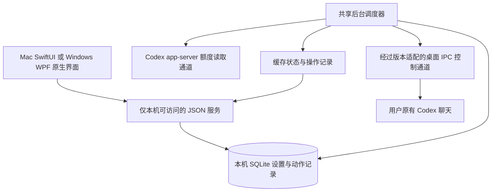
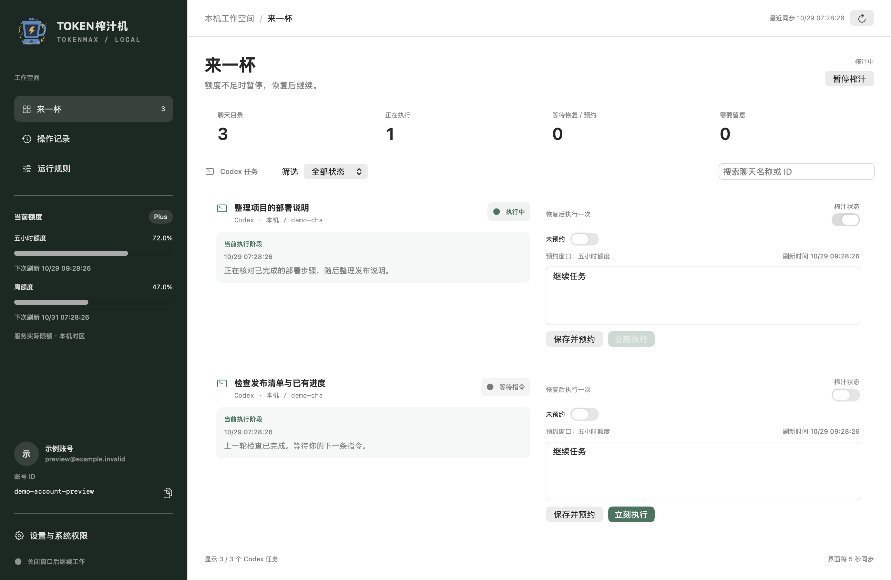
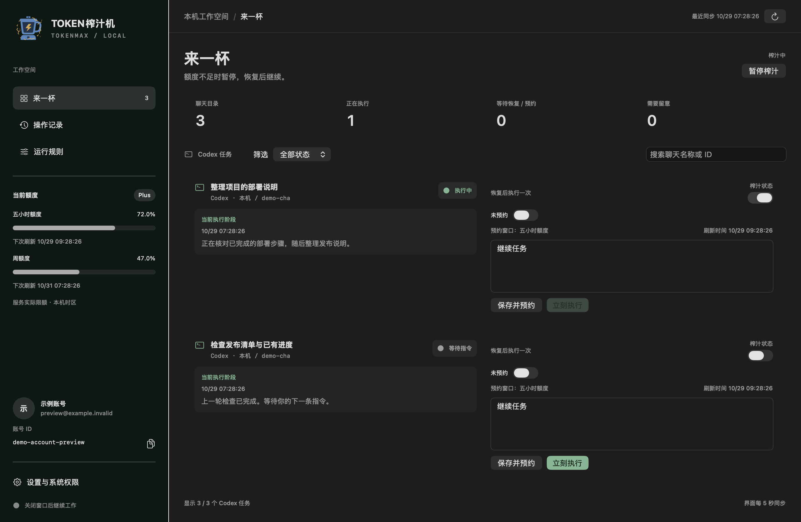
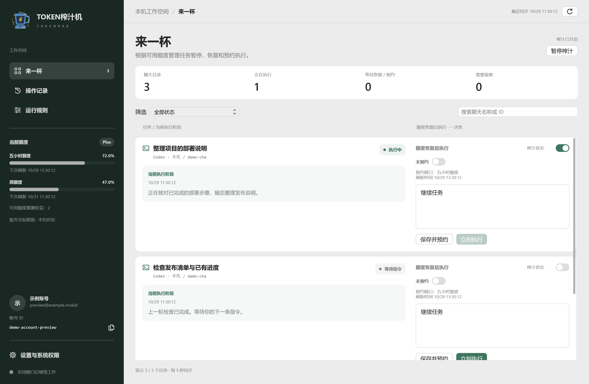
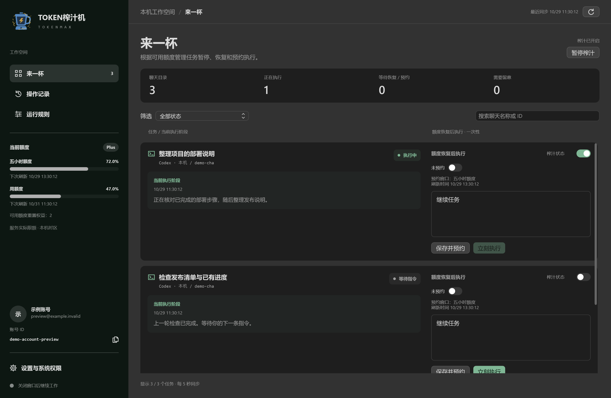

# TokenMax 代码架构审查与验收

日期：2026-10-29，Asia/Dubai。审查基线：`67dd090b445a16b6c8c3e2e02e0ac85dfdd03da0`，即 0.4.1 preview.11。修复候选：0.4.2。

## 给产品负责人的结论

继续采用“共享 Python 后台、Mac 和 Windows 各自的原生窗口、本机 SQLite 数据库”是合理的。它适合这个产品的规模，也能把核心控制规则同时提供给两平台。

目前最值得投入的是可靠性和维护边界。本轮修复了两项具体问题：程序包内生成缓存破坏 Mac 签名完整性，以及通信写入可能无限等待。下一步应拆分采集与控制、明确界面和后台的接口契约、整理 Windows 的集中式界面类，并补上分支合并前的自动检查。

完整审查覆盖后台、两平台原生端、安装器、打包、发布、品牌组件与测试设计。结论分为已复现并修复的缺陷、代码可直接确认的结构问题，以及需要产品决定或真实环境验收的事项；不把改进建议都当成现有故障。

## 产品是怎样工作的

原生界面主要读取缓存和提交用户意图。后台决定是否可以暂停或发送，并先把动作意图写入数据库，再通过桌面适配器执行。额度读取和聊天控制是两个通道。桌面控制依赖内部、版本敏感的通信，不能作为稳定公开的官方客户端控制 API 宣传。

## 现有设计中应保留的部分

- **发送有明确的防重复保护。** 即时指令、预约和自动续接使用持久化状态、唯一标识和结果复核。结果不确定时进入待核对状态，避免自动重复发送。
- **尊重用户操作。** 手动保持、等待审批或输入、账号变化、新回合以及目标变化都参与发送前复核；持久化修订号能阻止旧操作覆盖较新的许可。
- **窗口与后台分开管理。** 关闭窗口和退出应用有不同的生命周期；退出只回收应用拥有的进程组或 Windows Job，不按进程名称终止其他 Codex 工作。
- **数据留在本机。** 原生界面通过回环地址读取允许公开给界面的字段；HTTP 操作有 Host、Cookie、Origin 和自定义请求头检查。套接字或命名管道有所有者／来源检查。
- **保守解释额度。** 缺少窗口或服务许可不会被当作无限额度；额度恢复归因保存采样证据，官方原因保持未知。记录归因和执行许可分开处理。
- **测试与发行已有基础。** 固定运行环境哈希、原生夹具、自检入口、模拟截图、安装载荷校验以及私有文件扫描都可继续使用。

这些保护是后续整理代码时必须保持的行为契约。

## 两项已修复问题

### F01 P1 程序运行后会改写已签名的应用资源

**影响：** 应用第一次正常安装时可以通过签名检查，随后加载此前没有导入的 Python 模块，就可能在应用包里新增 `.pyc`，让资源完整性检查失败。运行中的服务不一定立即停止，但安装包与运行后的文件不再保持同一封存状态。

**原因：** 原生启动器使用 Python 的 `-I` 隔离模式，它会忽略 `PYTHON*` 环境变量，包括 CI 设置的 `PYTHONDONTWRITEBYTECODE`。同时，旧 DMG 检查是在只读挂载上执行自检；文件系统阻止缓存落盘，掩盖了这一运行行为。[Python 官方命令行说明](https://docs.python.org/3.12/using/cmdline.html)

**修复：** Mac、Windows 原生启动入口、后台进程启动器和构建自检都显式传递 `-B`；保留 `-I`。补充此前在真实使用中才发生的冷导入，并对可写临时副本检查文件摘要和运行后的签名。

**验收：** 冷导入和真实的隔离子进程自检均确认禁止写字节码；可写副本文件摘要未变，随后 Mac 签名验证通过。新生成缓存的反例测试能够使校验器失败。

代码：[原生启动](../../native/App.swift)、[共享启动命令](../../backend/platform_support.py)、[后台子进程](../../backend/owned_process.py)、[可写副本验证](../../scripts/verify_dmg.py)。

### F02 P1 通信写入等待没有纳入完整请求超时

**影响：** 如果对端停止接收数据，后台可能卡在“把请求写出去”这一步。原来的回复超时尚未开始计时，后面的额度采集和状态同步也会被拖住。

**证据：** 使用不连接真实客户端的阻塞写入器，30 毫秒配置下，旧桌面通道到 0.8 秒外部看门狗介入时仍未返回；旧额度通道到 0.3 秒仍未返回。桌面请求原有额外 0.5 秒协议余量，已在反例的等待边界中计入。

**修复：** 完整请求交换的超时包含写入和回复，独立广播也限制写入等待，桌面连接关闭限制等待时长。发送过程失败后的“不自动重发”规则继续由既有动作状态机执行。

**验收：** 同一阻塞模拟中，修复后的两个写入等待约 31–32 毫秒退出；另有短请求预算覆盖长默认预算、广播、连接关闭和待处理请求清理的测试。这是模拟阻塞的验证数据，不是生产网络延迟指标。

代码：[桌面通信](../../backend/desktop.py)、[额度通信](../../backend/rpc.py)、[超时回归](../../backend/tests/test_transport_deadlines.py)。

## 应当安排的架构改进

### F03 P2 采集、控制和保存集中在同一个循环

`guardian.run()` 连续完成账号核对、额度读取、桌面发现、目录刷新、手动请求、预约、任务控制及报告保存。目录刷新和任务控制又会读取相同聊天的状态。

**对用户的影响：** 聊天越多、某个会话越大或读取越慢，后续操作越晚得到处理。界面的刷新时间也不等于后台已完成一次新的完整采集。目前文档已经说明“采集间隔另加处理耗时”，这个说明应保留。

**建议：** 先把额度采样、状态采集和动作执行分开组织；每个聊天保留单一控制队列，并继续在发送前执行最终复核。同一轮只读快照可以复用，执行动作时重新取最新状态。不要把所有控制动作简单并发出去。

**完成标准：** 注入一个慢聊天时，额度采样仍能及时结束；同一聊天不会并发发送；暂停、手动保持和新用户回合仍能使排队动作失效。

代码：[调度主循环](../../backend/guardian.py)、[目录刷新](../../backend/catalog.py)、[后台任务控制](../../backend/guardian.py)。

### F04 P2 大会话仍依赖完整快照读取与解析

128 MiB 是有界接收限制，已经解决已知大于 64 MiB 的故障。接收后会提取较小的规范化状态，不能把它描述为“永久保存 32 份完整大会话”。不过，完整帧的接收、JSON 解析和内容指纹计算仍会产生瞬时内存及 CPU 开销。

**对用户的影响：** 更长或包含大量图像的会话仍可能读得慢；超过 128 MiB 时会被明确拒绝。

**建议：** 优先寻找经验证的摘要或增量读取方式；把状态展示需要的字段与发送前核对需要的字段分开，减少重复解析。为读取字节数、耗时及内存峰值设观测指标。不要继续无界增加接收上限。

**完成标准：** 常规轮询避免反复解析完整历史；保留超限拒绝、断线清缓存与自动重连测试；对大会话测量完整周期而不是只引用一次读取耗时。

代码：[帧接收与规范化](../../backend/desktop.py)、[历史尾部摘要](../../backend/stages.py)。

### F05 P2 界面协议和存储模型需要更明确的边界

界面状态由 `ui.Application.state()` 直接查询数据库并组合。`Store` 初始化同时创建表和设置数据库模式；本机协议没有明确的 `schema_version`。Mac 使用可解码结构体，Windows 大量使用字符串键的字典；规则边界、状态映射等信息在多处维护。

预览复查也确认了具体差异：旧夹具缺少 `quota_state` 时，Mac 和 Windows 对 Logo 状态的兼容默认值不同。最终公开预览使用显式提供当前字段的纯模拟夹具；原有旧版兼容测试夹具保留，用于后续统一兼容规则。

**对用户的影响：** 同一个字段变化可能在一个平台正常、另一个平台显示异常。连接旧后台时，这种兼容成本更加明显。现有后台最终复核仍是实际发送的保护边界，界面的默认值不应被当成发送授权。

**建议：** 定义版本化的状态／命令契约；把数据库读写收进清晰的存储接口；为任务、预约和发送回执建立明确的数据模型。让原生端消费同一份规则元数据和兼容性样例，逐步减少重复策略。

**完成标准：** 两平台共同通过正常、缺字段、旧字段形态、未知枚举和错误响应样例；不支持的版本可撤销许可，但不能靠缺失字段获得发送能力。

代码：[状态接口](../../backend/ui.py)、[存储](../../backend/guardian.py)、[Mac 状态模型](../../native/NativeState.swift)、[Windows JSON 与策略](../../windows/MissionManager.cs)。

### F06 P2 Windows 主文件职责过于集中

`windows/MissionManager.cs` 约 2,449 行，包含窗口构造、网络访问、进程管理、托盘、偏好、校验、自检和多种页面。Mac 的 `App.swift` 也集中管理较多系统与界面状态。

**对用户的影响：** 一个小功能可能牵动多个地方，修复 Windows 后漏改 Mac 或反过来的概率会增加。文件长本身不等于代码错误，职责交叉才是维护成本的来源。

**建议：** 先拆出后台客户端、后台进程宿主、应用生命周期和页面状态；Windows 再逐步分离各页面。把较大的离线自检实现独立成文件，保留现有命令入口。事务和异常处理使用清晰的多行结构。

**完成标准：** 拆分前后共用同一套输入法、草稿、窗口关闭、托盘弹层、幂等退出和控制撤销测试；主界面继续使用 WPF／SwiftUI。

代码：[Windows 原生端](../../windows/MissionManager.cs)、[Mac 应用模型](../../native/App.swift)。

### F07 P2 历史查询和数据演进需要长期规划

即时发送回执查询会扫描全部同类请求，再选每个聊天的最新一条；状态接口也扫描历史接管请求。任务与预约大量使用 JSON 字段，当前通过建表和兼容默认值演进，尚无统一的数据库版本迁移入口。

**对用户的影响：** 使用时间长、记录很多时，界面刷新成本会增加；以后更改存储格式也更难明确验证从哪些旧版本能够升级。当前数据量较小时，这不等于已经发生性能故障。

**建议：** 为常用的请求类型、状态、聊天键和账号范围建立可索引的查询；增加显式数据库版本、迁移及备份恢复测试。归档策略应由用户决定；保留防重复发送所需的标识，避免清理历史后失去幂等保护。

**完成标准：** 使用大规模模拟历史测量状态接口耗时；升级失败能回退；归档后重复请求仍不会再次执行。

代码：[回执查询](../../backend/immediate.py)、[状态组合](../../backend/ui.py)、[存储初始化](../../backend/guardian.py)、[账号范围兼容迁移](../../backend/identity_scope.py)。

### F08 P2 Mac 的外部客户端依赖仍可进一步隔离

Windows 的启动路径允许额度通道先工作，再尝试可选的桌面控制连接。Mac 则先要求桌面版本匹配，失败后整个适配器启动失败。Mac 的 CLI 选择还优先使用 `PATH` 中的 `codex`，而兼容性检查针对的是已安装桌面应用版本。

**对用户的影响：** Mac 桌面版本变化可能同时使额度显示不可用；不同机器的 CLI 来源也可能不同，增加排查成本。这些情况目前会保守地停止自动恢复，不代表存在已确认的越权发送。

**建议：** 把“可读取额度”和“可控制桌面聊天”分成明确能力；控制不兼容时保留经核验的只读能力。固定并核验 CLI 来源，或明确展示当前实际使用的来源与兼容状态；复用 Windows 已有的来源核对思路。

**完成标准：** 桌面版本不支持时，控制保持关闭；可用的额度读取独立验证；CLI 来源变化有明确诊断和测试。

代码：[适配器启动](../../backend/desktop.py)、[CLI 选择](../../backend/guardian.py)、[Windows 来源核对](../../backend/compatibility.py)。

### F09 P2 缺少合并前自动验证关卡

仓库的发行和历史图库工作流由 `main` 推送或手动触发；没有覆盖普通拉取请求的验证工作流。现有发行流程的两平台构建、来源、哈希和模拟截图校验值得保留。

**对用户的影响：** 独立分支可以有修复代码，但在合并前缺少自动、可重复的两平台状态。合并后才发现构建失败，会把问题带入发行流程。

**建议：** 单独增加不发布的 PR 验证工作流，运行后台、原生契约、打包和私有文件检查；在合并规则中要求这些检查通过。发布仍由明确的主分支或发行操作触发。

**完成标准：** 一个故意失败的测试能在合并前显示失败；验证任务没有发布权限，也不会启动真实聊天。

代码：[发行工作流](../../.github/workflows/release.yml)、[历史图库维护](../../.github/workflows/release-gallery-backfill.yml)。

### F10 P2 需要明确新聊天的默认接管规则

默认配置启用自动发现。全局调度开启后，新发现且没有明确撤销许可的已加载本机聊天，可以被自动纳入管理。已关闭的单任务许可会被尊重。

**对用户的影响：** 用户可能把“开启全局调度”理解为只运行自己逐项选中的聊天，而实际行为还可能包括新加载聊天。这是需要明确的产品规则，并非本轮擅自改变的默认行为。

**建议：** 在“仅管理明确选择的聊天”和“默认接管新聊天”之间选定规则，让初始化、按钮状态和使用说明一致。如果保留自动接管，应让用户能够清楚知道并控制该规则。

**完成标准：** 新聊天、重新打开的聊天、曾撤销许可的聊天以及账号切换都有明确的许可测试。

代码：[默认配置](../../backend/config.example.json)、[自动发现与接管](../../backend/guardian.py)、[使用指南](../USER_GUIDE.md)。

### F11 P2 合盖辅助服务开放前需要补齐命令超时

当前预览拒绝启用管理员辅助服务。未来正式签名版本的辅助服务会通过同步 `runCommand()` 调用 `pmset`；该函数的读取和进程退出等待没有时间上限。辅助服务的恢复和看门狗共用串行队列。

**对用户的影响：** 在将来启用此功能后，若系统命令卡住，恢复睡眠的检查也可能被拖住。当前未开放的预览不能宣称已经通过真实合盖验收。

**建议：** 在开放前给系统命令设置完整期限、退出回执和恢复重试；对崩溃恢复日志、断电、低电量及热压力进行隔离测试，再安排真实硬件验收。

**完成标准：** 卡住的模拟命令不能阻塞看门狗；失败后仍有可验证的恢复路径。此项作为启用前置条件，不在普通版本测试中修改真实电源设置。

代码：[系统命令包装](../../native/Shared.swift)、[辅助服务](../../native/PowerHelper.swift)。

### F12 P3 品牌测试应具备可重复的开发环境

SVG／浏览器、Swift 和 WPF 有各自的原生绘制实现。品牌浏览器测试依赖调用方提供 Playwright 和浏览器位置，发行工作流尚未执行这组测试。原生离线预览也会受真实时钟影响：过期的示例日期可能让额度和 Logo 显示为待同步。本轮公开预览已对纯模拟日期做平移，未采用真实额度。

**对用户的影响：** 未来改 Logo 或动态效果时，平台间可能出现细微差异，减少动态效果也容易被漏验。

**建议：** 记录并固定开发测试依赖，把浏览器回归纳入不发布的验证流程；给离线渲染注入固定时钟，将几何、状态和配色常量尽量集中管理，并保留两平台原生渲染比较。当前品牌组件继续以 1.2.0 的 SVG 和原生代码为准，归档 Figma 链接不充当最新版本依据。

**完成标准：** 五种状态、深浅主题、静态导出及减少动态效果在新环境能够一条命令复验；不把浏览器组件的测试结果当成真实菜单栏或 Windows 托盘验收。

代码：[品牌浏览器测试](../../design/brand/test.cjs)、[Swift Logo](../../native/JuicerLogo.swift)、[WPF Logo](../../windows/JuicerLogo.cs)。

### F13 P3 应补充不含聊天内容的运行诊断

后台已有阶段名称、错误类型、连续失败次数和状态时间，但缺少每个采集阶段的耗时、完整周期耗时、接收大小和重连次数等连续指标。

**对用户的影响：** “连接待恢复”可以阻止错误控制，但难以回答究竟是额度读取慢、某个大聊天慢，还是本机数据库等待。

**建议：** 只记录必要的时长、大小、错误代码和采样时间；提供可脱敏的诊断导出。界面可用“最近成功采集完成时间”帮助理解状态新鲜度，诊断不包含聊天正文、账号凭据或完整协议帧。

**完成标准：** 用模拟故障能区分主要阶段；导出样本通过私有字段检查；性能结论基于一组采样，明确样本范围。

代码：[运行报告](../../backend/guardian.py)、[状态接口](../../backend/ui.py)、[启动诊断](../../windows/MissionManager.cs)。

## 本轮验证结果与边界

### 代码与隔离验证

- Mac 后台：323 项测试，3 项按平台跳过，失败和错误均为 0。
- 宿主与资源校验器：31 项测试全部通过。
- Mac 原生状态、控制、输入法与草稿、关闭窗口不退出、幂等退出、测试子进程回收和阻塞退出检查通过；未启动生产后台。
- Mac 候选 DMG：只读挂载、自检、签名检查及可写副本冷导入后的资源和签名复查通过；管理员辅助服务拒绝启用。
- Windows 真实设备上的隔离构建通过。平台、宿主、进程回收、额度归因及事件来源抽查共 129 项，1 项按平台跳过，失败和错误均为 0；另 5 项通信超时测试通过。这不是 Windows 完整后台测试套件。
- Windows 原生规则编辑／草稿及生命周期夹具通过，包含窗口隐藏、弹层重开、重复退出和清理时限；夹具没有创建真实系统托盘或生产后台。
- 两平台深浅色原生界面预览使用模拟数据，附有不启动后台、不读取私人偏好的回执。
- 品牌浏览器回归通过：实际动画帧变化、暂停、系统及手动减少动态效果、深浅主题、状态隔离、静态 SVG 和无障碍标签等。

### 真实环境只读补验

Windows 的候选后台在隔离目录中，已完成真实额度读取、版本适配的控制通道握手、聊天状态读取，以及关闭自身测试连接后的重新连接。没有发送聊天消息或中断任务。这证明该采样时点的只读连接可用，不代表已经安装候选版，也不代表真实暂停／发送验收通过。

Mac 正在运行的安装版通过缓存与原生界面只读核对；本轮没有用它制造低额度、暂停真实工作或发送自检指令。候选包的验证与正在运行的安装版本分别记录。

### 保留未完成的验收

- **真实低额度暂停、自然额度恢复、续接的完整链路。** 已有模拟测试；需要自然事件或用户专门指定的可打断测试聊天。
- **官方提前恢复事件。** 本轮没有现场触发或观察到这类事件；采样归因继续标为推断。
- **Windows 安装升级与真实托盘交互。** 完成了真实设备隔离构建、原生夹具和只读连接；没有覆盖现有安装，也没有通过远程桌面操作真实托盘。
- **Mac 菜单栏小图标在真实深浅背景上的最终观感。** 原生主窗口和品牌组件已验证；系统菜单栏工具曾超时，不能将其等同于锁屏或将离线图当作此项验收。
- **合盖、手动睡眠、锁屏后的联网发送。** 当前预览的辅助服务限制仍在，不通过修改系统电源设置来补做此项。

## 建议的改进顺序

1. **交付并审查本轮可靠性修复。** 保留可写资源与通信超时反例测试，完成两平台打包校验，再安排更新安装。源码、候选包、已安装版本分别标注。
2. **建立合并前检查与统一接口样例。** 优先处理 F09、F05；让今后每个改动在合并前证明两平台兼容。
3. **优化采集延迟。** 按 F03、F04、F07、F13 减少重复读取，测量完整周期，并用模拟大会话与大历史验证。
4. **逐步分离原生端职责。** 处理 F06、F08、F12，每次只迁移一块，沿用现有原生界面和行为测试。
5. **单独决定接管规则与辅助服务开放条件。** F10 需要产品规则确认；F11 在功能开放前完成。

整个过程应保留已有防重复发送、手动保持、审批／输入保护、账号隔离、旧数据兼容和双原生窗口。当前规模继续使用单个本机后台和 SQLite，重点是清晰分层与明确期限。

## 预览与证据

以下预览来自 0.4.2 候选的原生离线渲染，仅展示模拟数据。运行资源和通信超时属于行为修复，不能从静态图片证明。

可公开的隔离测试汇总见同目录 `validation-summary.json`。真实账号、聊天正文、运行数据库、设备连接信息和本地私人验收记录不包含在本报告或仓库产物中。
